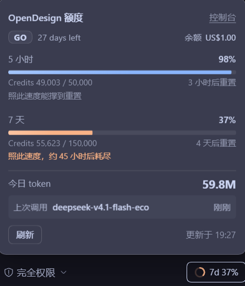
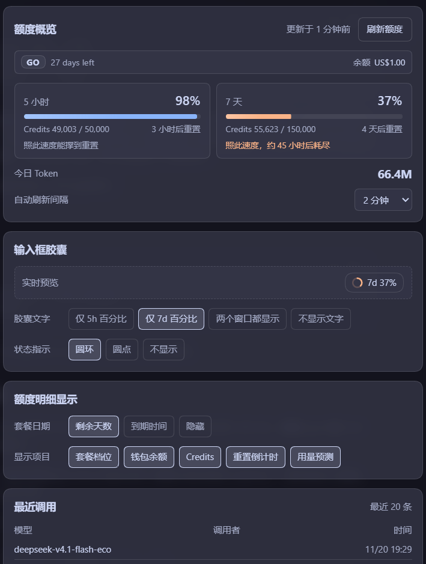

# dsh-opendesign-runway

在 DeepSeek Harness 的输入框旁显示 OpenDesign 的套餐额度和钱包余额。



## 显示内容

输入框右边的胶囊显示当前最需要看的数字。点开后是详情面板：

- 钱包余额
- 两个额度窗口（5 小时和 7 天）各自的剩余百分比、进度条、重置倒计时
- 每个窗口的绝对数额，例如 `48493 / 50000`
- 5 小时和 7 天窗口都会根据已消耗额度估算能否撑到重置
- OpenDesign 提供订阅日期时，显示套餐周期结束日。确认将在周期结束时取消的套餐，显示为套餐到期日
- 今日 token 用量
- 上次调用的模型和时间

额度和用量的颜色随剩余比例变化：剩余 50% 以下变黄，20% 以下变红。

打开时先显示上一次的读数，同时开始读取新的。上一次读数超过三分钟没更新的，胶囊右侧会亮起一个琥珀色小圆点，明暗交替，表示正在刷新；面板里写“正在刷新”。三分钟以内的不标记，因为下一次读取返回的通常是同一批数字。

## 胶囊的显示方式可调

设置页里有两组选项：

**胶囊文字**

- 仅 5h 百分比
- 仅 7d 百分比
- 两个窗口都显示
- 不显示文字

**状态指示**

- 圆环（按剩余比例画弧）
- 圆点
- 不显示

两个都选“不显示”时，胶囊整体隐藏，不留空框。选择会保存在浏览器本地，重启后仍然有效。

面板里每一项都能单独关掉：套餐档位、钱包余额、Credits 数额、重置倒计时、用量预测。套餐周期结束日可以选显示剩余天数、显示具体日期，或整个隐藏。关掉的项目不会占位置，剩下的自动补上。

额度概览可以选每 1、2、5 或 10 分钟自动刷新，默认 1 分钟，也可以随时点“刷新额度”。设置页的最近调用最多展示 20 条，每页 5 条。



## 安装

从 npm 安装：

```
dsh plugin --profile desktop add dsh-opendesign-runway
```

从 GitHub 安装：

```
dsh plugin --profile desktop add github:saltfish060/dsh-opendesign-runway
```

装完重启 DSH。

## 首次使用要绑定凭据

插件读不到额度时会显示“未绑定”。打开设置 → OpenDesign，有两种绑定方式：

1. 点“登录 OpenDesign…”，在弹出的临时窗口里登录。窗口关闭后插件自己取 cookie 并验证。
2. 从浏览器复制整条 Cookie 请求头，粘贴到输入框，点保存。

登录页有 Turnstile 验证，所以没办法在插件里自动填表提交，只能由人在窗口里点。

凭据存在 DSH 的凭据服务里，不写进任何配置文件。

## 数据来源

OpenDesign 控制台自己的两个接口：

- `/api/v1/workspaces` — 找到账号对应的 workspace
- `/api/v1/workspaces/:id/billing/coding-plan-usage` — 额度窗口的用量、上限、重置时间

本机的 `~/.amr/config.json` 只读，插件不会改动它。

## 关于“撑到重置”那行推算

两个窗口都按各自的开始时间（`windowStart`）和读数采集时刻估算消耗速度。短窗口刚开始的 5 分钟会提示继续积累数据，之后用分钟或小时显示预计耗尽时间。

## Agent 工具

插件注册了一个 `quota_lens` 工具，返回结构化的读数，包括凭据身份、钱包金额、各窗口的百分比和绝对数额、以及每次 HTTP 请求的记录。读数失败时返回具体原因，不会编造数字。

## 开发

```
node --test
```

测试覆盖额度和用量的解析、凭据回退、显示偏好、缓存、速率推算。

## 许可

MIT
